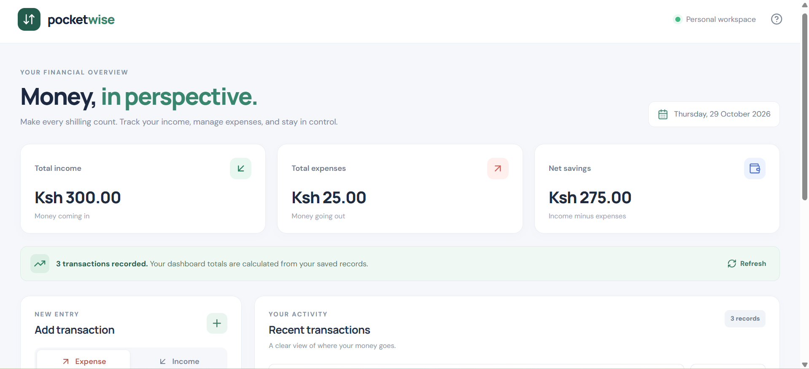
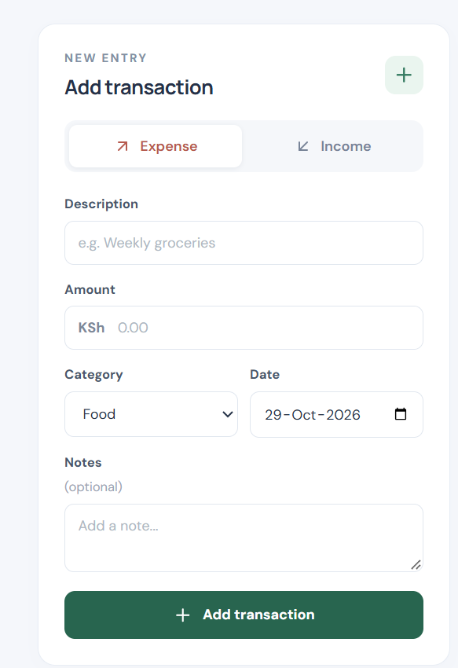

# Expense Tracker (Task 2)

> **CodeNova Full Stack Internship - Batch 01**
> Remote / Online | 4 Weeks Self-Paced | Deadline: 06 November 2026

A personal finance tracker where you log income and expenses, tag them with categories and dates, and see your running balance, total income, and total spend updated in real time. Dual-layer validation (client + server) means bad data never reaches the database.

---

## Screenshots





---

## Tech Stack

| Layer | Technology |
| :--- | :--- |
| **Frontend** | React 19 + Vite, DM Sans / Manrope fonts |
| **Backend** | Node.js + Express (ESM) |
| **Database** | PostgreSQL via Supabase and `pg` |
| **Styling** | Custom CSS — responsive desktop/mobile layout |
| **Validation** | Client-side + independent server-side field validation |

---

## Features

- Dashboard totals — income, expenses, and net savings updated on every change
- Add income or expense entries with title, amount, category, date, and optional notes
- Type toggle — switch between income and expense mode in the form
- Search and filter transaction history by keyword and type
- Delete transactions with immediate balance recalculation
- Server-side validation with detailed field-level error messages
- Responsive — full desktop table collapses to a mobile card list
- No API keys or external credentials required

---

## Project Structure

```text
task-2-expense-tracker/
├── backend/
│   ├── src/
│   │   ├── db.js              # PostgreSQL pool, migration runner, summary helper
│   │   ├── server.js          # Express entry point
│   │   ├── validation.js      # Server-side field validation
│   │   └── routes/
│   │       └── transactions.js
│   ├── data/.gitkeep
│   └── .env.example
├── frontend/
│   ├── src/
│   │   ├── components/
│   │   │   ├── BalanceCard.jsx
│   │   │   ├── TransactionForm.jsx
│   │   │   ├── TransactionTable.jsx
│   │   │   ├── Toast.jsx
│   │   │   └── Header.jsx
│   │   ├── App.jsx
│   │   ├── api.js
│   │   ├── main.jsx
│   │   └── styles.css
│   ├── .env.example
│   └── vite.config.js
├── screenshort1.png
├── screenshort2.png
└── README.md
```

---

## API Reference

**Base URL:** `http://localhost:5000/api`

| Method | Endpoint | Description |
| :--- | :--- | :--- |
| `GET` | `/health` | Health check |
| `GET` | `/transactions` | List all — supports `?search=` and `?type=income\|expense` |
| `GET` | `/transactions/summary` | Total income, expenses, net savings, count |
| `POST` | `/transactions` | Create a transaction |
| `DELETE` | `/transactions/:id` | Delete a transaction |

### POST body example

```json
{
  "type": "expense",
  "title": "Groceries",
  "amount": 35.50,
  "category": "Food",
  "date": "2026-10-21",
  "notes": "Weekly shopping"
}
```

**Validation rules (server-enforced):** `type` must be `income` or `expense`; `title` and `category` required; `amount` must be a positive finite number ≤ 1,000,000,000; `date` must be a valid ISO `YYYY-MM-DD` date not more than one day in the future; text length limits apply. Returns `400` on failure, `404` for missing records.

---

## Database Model

`transactions` table:

| Column | Type | Notes |
| :--- | :--- | :--- |
| `id` | INTEGER PK | Auto-increment |
| `type` | TEXT | `income` or `expense` |
| `title` | TEXT | Description, max 100 chars |
| `amount` | REAL | Positive, max 1,000,000,000 |
| `category` | TEXT | Max 40 chars |
| `date` | TEXT | ISO `YYYY-MM-DD` |
| `notes` | TEXT | Optional, max 500 chars |
| `created_at` | TEXT | UTC timestamp |

---

## Local Setup

### Prerequisites
- Node.js v22+
- npm

### Backend (port 5000)

```bash
cd task-2-expense-tracker/backend
npm install
cp .env.example .env
npm run dev
# API running at http://localhost:5000
```

### Frontend (port 5173)

```bash
cd task-2-expense-tracker/frontend
npm install
cp .env.example .env
npm run dev
# Open http://localhost:5173
```

### From the repo root

```bash
npm run backend:task2   # Start backend  → http://localhost:5000
npm run frontend:task2  # Start frontend → http://localhost:5173
```

---

## Deployment

| Target | Platform | Config |
| :--- | :--- | :--- |
| Frontend | Netlify | Base: `frontend`, Build: `npm run build`, Publish: `dist`, Env: `VITE_API_URL` |
| Backend | Render | Root: `backend`, Start: `npm start`, Env: `DATABASE_URL`, `PORT`, `CLIENT_ORIGIN`, `NODE_ENV` |

> See [DATABASE_SETUP.md](./DATABASE_SETUP.md) for Supabase, Render, migration, and connection configuration.
